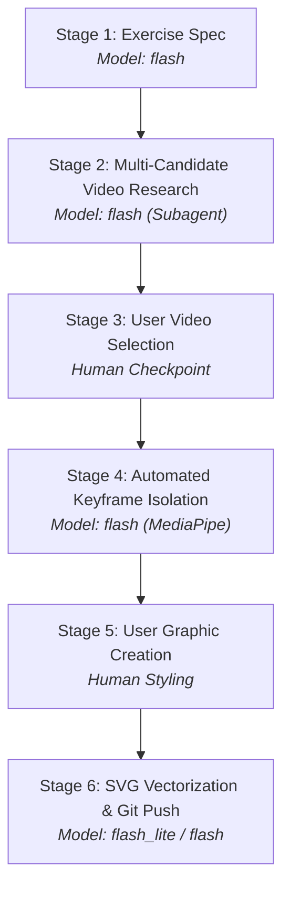

# Exercise Asset Pipeline Skill

Use this skill to research, isolate, vectorize, and integrate high-detail exercise illustrations for the **Training Planner** Android app.

---

## 1. Pipeline Overview & Model Routing

The pipeline combines automated computer-vision keyframe extraction with human aesthetic control over stylized illustrations:



| Stage | Responsible Role | Recommended Model | Output |
| :--- | :--- | :--- | :--- |
| **1. Exercise Spec** | Planner | `flash` | Domain description, biomechanical target angles, key postures |
| **2. Video Research** | `research` subagent | `flash` | 2–3 candidate video reps from whitelisted channels |
| **3. Video Selection** | User | Human | Chosen candidate video and rep timestamp |
| **4. Frame Isolation** | CV Hunter Tool | `flash` | Pristine uncut keyframes (0% limb cutoff, same rep) |
| **5. Graphic Creation** | User | Human | Stylized 2D digital illustration |
| **6. SVG & Git Integration**| Asset Integrator | `flash_lite` | $512 \times 512$ SVG in assets, committed & pushed to batch branch |

---

## 2. Stage-by-Step Execution Protocol

### Stage 1: Exercise & Biomechanical Specification (`flash`)
1. Provide the canonical exercise name, description, and category.
2. Define primary and secondary muscle groups.
3. Specify exact biomechanical criteria for all key exercise positions (exercises support $N \ge 1$ ordered graphics via `ExerciseImage`):
   - **Position 0 (`orderIndex = 0` — Setup / Start / Lockout):** e.g., dead hang ($180^\circ$ elbow), plank lockout, top handstand lockout. This acts as the primary thumbnail in list cards.
   - **Position 1 (`orderIndex = 1` — Peak Contraction / Bottom / Flexion):** e.g., chin over bar ($<30^\circ$ elbow), $90^\circ$ elbow dip, head-to-floor tripod.
   - **Positions 2..N (`orderIndex = 2..N` — Multi-stage progressions):** e.g., Bent-Arm Tuck Press stages 1–5, transition postures, eccentric catch positions. All graphics are displayed in sequence in `ImageGallery` on `ExerciseDetailsScreen`.

### Stage 2: Multi-Candidate Video Research (`flash` Subagent)
> [!IMPORTANT]
> Search **exclusively** across the three approved tutorial channels:
> 1. **Calisthenicmovement** (`@Calisthenicmovement`)
> 2. **FitnessFAQs** (`@FitnessFAQs`)
> 3. **SaturnoMovement** (`@SaturnoMovement`)

1. Delegate candidate video hunting to a background `research` subagent.
2. Locate 2–3 separate candidate videos or repetitions filmed with:
   - High-contrast background.
   - Fixed side-profile or $45^\circ$ oblique camera angle.
   - Wide framing that keeps head, hands, and feet completely inside the frame throughout the entire movement.
3. Download 720p clips using `yt-dlp` (`BypassSandbox: true` for network fetch):
   ```bash
   yt-dlp -f "136/bestvideo[height<=720]/best[height<=720]" "<URL>" -o "temp_<exercise>_<id>.mp4"
   ```

### Stage 3: User Video Selection Checkpoint
1. Present the 2–3 candidate clips with:
   - Channel name & video title.
   - Timestamp range.
   - Perspective description (e.g., pure lateral vs $30^\circ$ diagonal).
   - Side-by-side thumbnail strip artifact.
2. Wait for the user to select which video candidate to extract from.

### Stage 4: Automated Keyframe Isolation (`auto_frame_hunter.py`)
Run the MediaPipe 33-point pose estimation hunter on the chosen video:
```bash
/Users/lukaszwitkowski/.gemini/antigravity/brain/a5e3fd9e-1b57-47bc-af6d-664ce111034d/scratch/venv/bin/python3 \
  tools/svg_converter/auto_frame_hunter.py
```

**Quality Invariants Enforced:**
- **Single Continuous Repetition:** Both Position 1 and Position 2 MUST be sampled from the *same continuous repetition* ($\Delta t \approx 1.2\text{s}\text{--}4.0\text{s}$) to preserve 1:1 athlete proportions, lighting, and camera perspective.
- **Strict Boundary Margins:** All 33 landmarks (especially head, wrists, ankles, toes) must maintain $>3.5\%$ safety clearance from frame edges ($y \in [0.035, 0.965]$, $x \in [0.035, 0.965]$).
- Save extracted frames to `comparison_images/raw_frames/<exercise>_<pos>.png`.

### Stage 5: User Illustration Creation
1. Provide the extracted pristine PNG frames to the user via artifact links.
2. The user creates their custom stylized graphic (e.g., flat 2D color illustration with line art, matching the reference design).
3. The user uploads the stylized image back to the chat.

### Stage 6: SVG Vectorization, Asset Placement & Git Push (`flash_lite`)
1. Run `image_to_svg.py` on the user-provided graphic:
   ```bash
   /Users/lukaszwitkowski/.gemini/antigravity/brain/a5e3fd9e-1b57-47bc-af6d-664ce111034d/scratch/venv/bin/python3 \
     tools/svg_converter/image_to_svg.py \
     -i "<user_image_path>" \
     -o "exercise/src/main/assets/exercise_images/<exercise_uuid>.svg" \
     --mode color
   ```
2. Verify SVG validity and size ($<80\text{ KB}$, $512 \times 512$ viewport).
3. Commit and push the changes to the shared batch branch (`BypassSandbox: true`):
   ```bash
   git add exercise/src/main/assets/exercise_images/
   git commit -m "feat(exercise): add vector illustration for <Exercise Name>"
   git push origin <shared-batch-branch>
   ```

---

## 3. Git & Workspace Hygiene
- All downloaded videos (`*.mp4`), temporary frames (`comparison_images/`), and local Python scripts (`tools/`) must remain ignored by git in `.gitignore`.
- Only production SVGs placed in `exercise/src/main/assets/exercise_images/` (and corresponding Room/JSON metadata) are committed to git.
